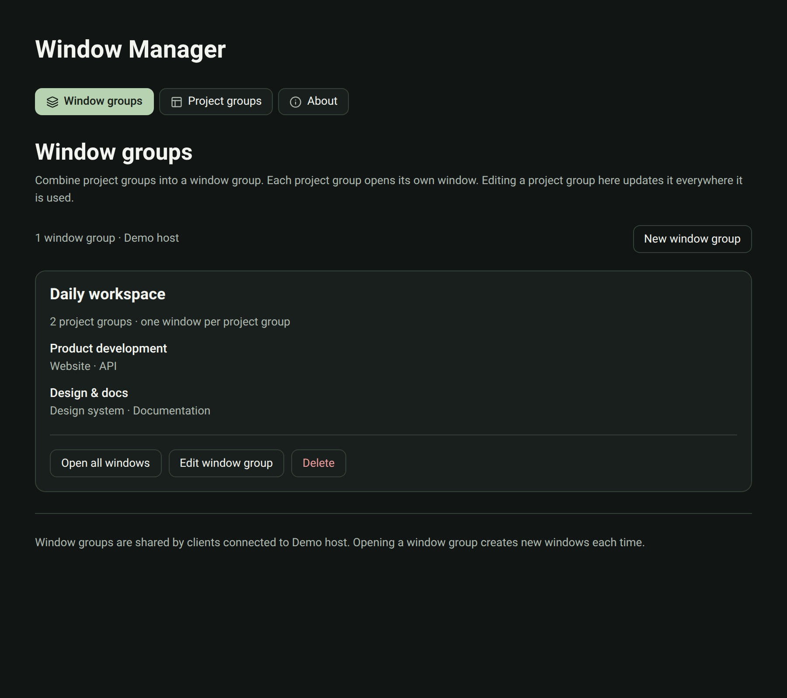
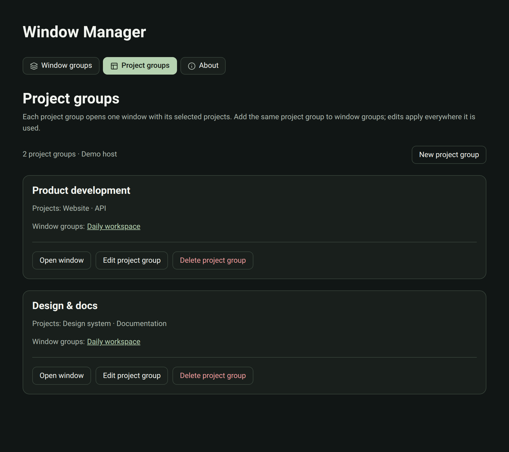

# Window Manager for Paseo


Open your Paseo projects in separate desktop windows. Save the projects for each window as a
project group, combine project groups into named window groups, and open a whole window group
with one click.

Requires **Paseo Desktop 0.13.2 or later** (verified with 0.13.2 through 0.16.x). Created by **Ben Klingner**.

## Install

With plugins enabled in Paseo, run:

```sh
paseo plugin add git:BenKlingner/window-manager
```

Plugins run as trusted code on your Paseo host and inside the app. Review the source before installing.
The **Window Manager** row in the sidebar header (or **Window Manager** in the Command Center)
opens a screen with **Projects**, **Window groups**, and **Project groups** tabs. Each row has its
own button to open it in new windows. The settings button on that screen, **Settings → Plugins →
window-manager → Window Manager**, and **Window Manager: settings** in the Command Center all open
the editor for project groups and window groups.

## Features

- Pick any project on the host from a searchable list and open it in a new window.
- Save project groups. Each project group opens one window showing only its selected projects.
- Combine shared project groups into window groups and open every window in a window group at once.
- Edit a project group once and every window group that uses it is updated.
- Settings are stored on the host and shared with every client connected to it.
- Works in desktop and compact layouts, with colors that follow your Paseo theme.

See [the overview](OVERVIEW.md) for behavior and limitations, and
[the security notes](SECURITY.md) for what the plugin reads and writes.

## Screenshots

The plugin UI below uses fictional demo projects and window groups.

### Window groups

Combine saved project groups into a window group and open one window per project group.



### Project groups

Choose which projects share a window, and see the window groups that use each project group.



## Platform support

Opening windows works only in Paseo Desktop. The plugin asks the desktop app to create each
window through the same internal call that Paseo's own **Open in new window** project action
uses, then sets up that window's sidebar through the app's local preferences. The plugin
contains no operating-system-specific code, and Paseo creates windows the same way on every
platform, so the expected support is:

| Platform | Status |
| --- | --- |
| Linux, X11 (Zorin OS 18, GNOME) | Tested. All development and live testing happened here. |
| Linux, Wayland | Expected to work. Not yet tested. |
| macOS | Expected to work. Not yet tested. |
| Windows | Expected to work. Not yet tested. |
| iOS, Android, browser | Settings can be edited. Windows cannot be opened. |

If you run the plugin on an untested platform, please [report the result](https://github.com/BenKlingner/window-manager/issues),
whether it worked or not, with your Paseo version and operating system.

Launching depends on desktop behavior that is not part of Paseo's public plugin API, so each
Paseo release is verified separately. The plugin is verified with 0.13.2 through 0.16.x. A newer
release still loads and launches, but the plugin shows a notice until that release has been
verified and the range in `client/compat.ts` raised.

## Known limitations

- Each launch creates new windows. It does not focus or close windows that are already open.
- Refreshing a window can reload another window's last saved project filter. Reopen the project group or
  window group to restore it.
- Names label your saved setup. They do not change the native window title, and window
  positions and sizes are not saved.
- One launch runs at a time across all Paseo windows. A second launch waits for a clear message.

## Development

```sh
npm ci --ignore-scripts
npm run typecheck
npm test
npm run test:ui
```

`npm test` covers the launcher, the storage write guard, settings validation, and migrations with
an in-memory storage. `npm run test:ui` renders the real settings and menu components with
React Native Web and a simulated SDK in headless Chromium, in light and dark themes and in wide
and compact layouts. It uses Playwright's bundled Chromium, or set `CHROMIUM_PATH` to another
Chromium-based browser. Neither suite opens native windows.

For local testing, install the checkout and reload the plugin after source edits:

```sh
paseo plugin install /absolute/path/to/window-manager
paseo plugin reload window-manager
```

Then open a window group containing a two-project group followed by a single-project group and check
both windows' sidebar selections, not just the window count. Do not restart the Paseo daemon to
pick up changes.

## Support

[Report a bug or suggest a feature](https://github.com/BenKlingner/window-manager/issues).
For bugs, include your Paseo version, operating system, display server, and steps to reproduce.

## License

[MIT](LICENSE).

Window Manager is an independent plugin and is not affiliated with or endorsed by the Paseo team.
